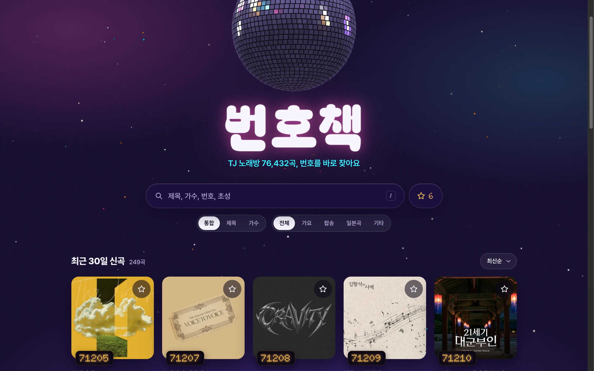
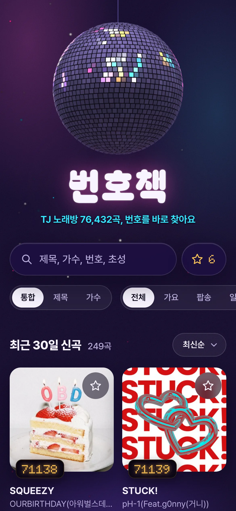
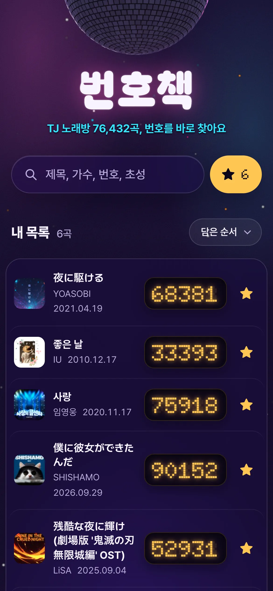
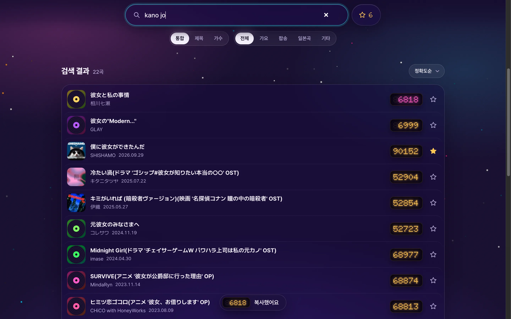

# 번호책: TJ 노래방 번호 찾기

TJ미디어 반주곡 7만 6천여 곡의 번호를 브라우저에서 바로 찾습니다. 한 번 열어 두면 인터넷이 안 되는 지하 노래방에서도 찾을 수 있습니다.

https://alfex4936.github.io/tj-media-karaoke-api/

  
  

- 제목, 가수, 작사, 작곡, 곡 번호
- 초성 (`ㅅㄹ` → 사랑), 입력 중인 글자 (`사ㄹ`)
- 일본 노래는 로마자로 (`kano jo` → 彼女, `yoru ni kakeru` → 夜に駆ける)
- 가요 / 팝송 / 일본곡 필터, 정확도·최신·번호·제목·가수 정렬
- 별표로 내 목록에 담아 두고 노래방에서 큰 번호만 보고 바로 예약
- 홈 화면에 추가하면 앱처럼 열리고, 오프라인에서도 동작

곡 목록은 매월 1일 TJ미디어에서 새로 받아 갱신합니다.
